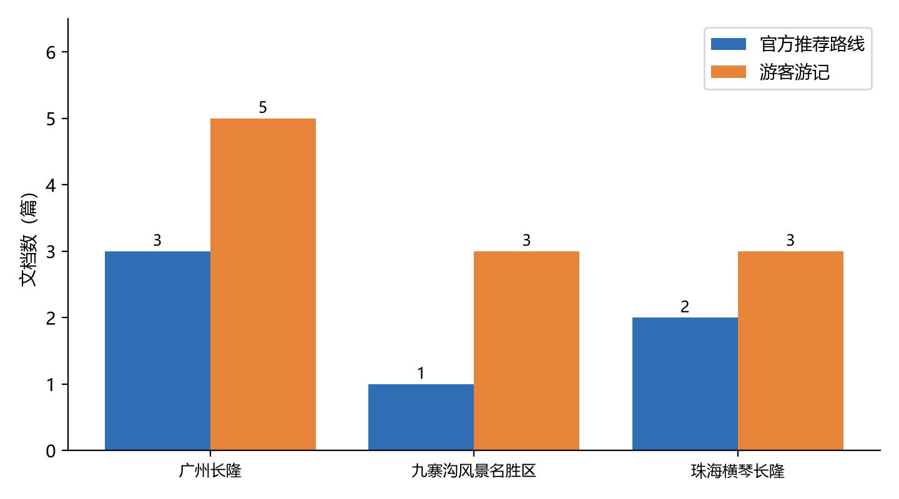
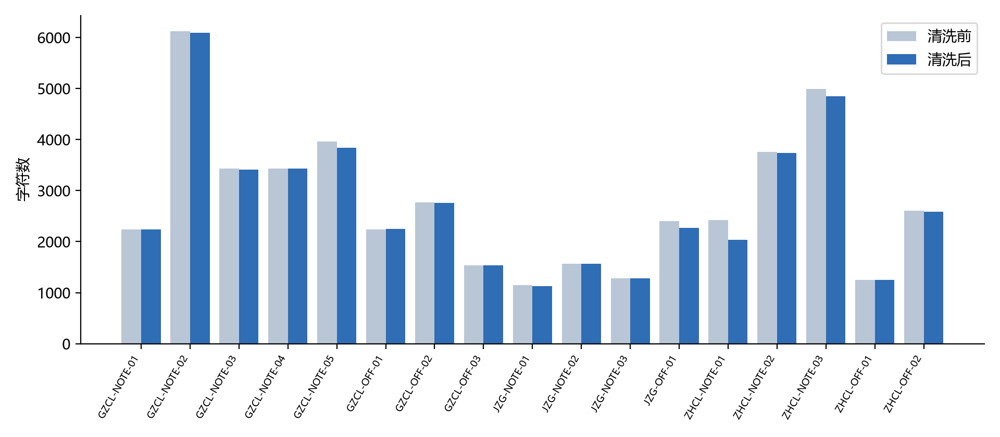
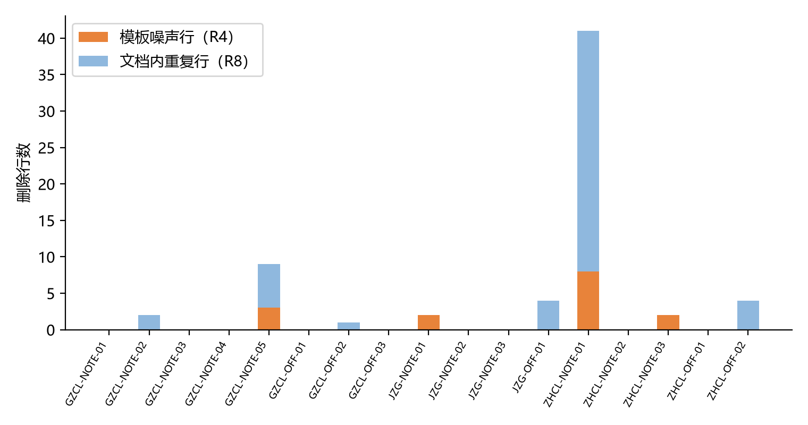
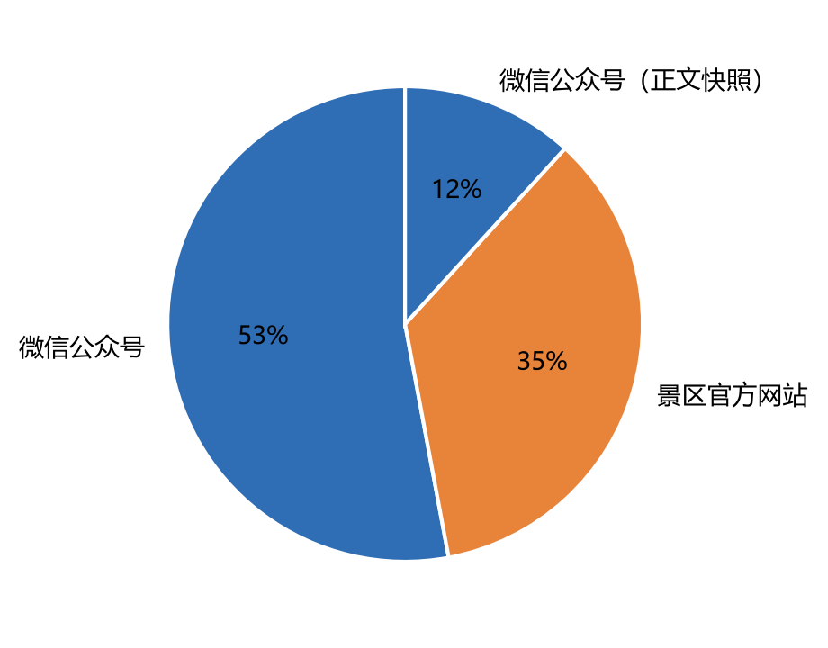

# 数据质量检查报告

> 由 src/quality_check.py 生成，数据源是 data/processed/documents.json。

## Q1 各景区文档数量

| 景区 | 官方推荐路线 | 游客游记 | 是否达标（≥1 / ≥3） |
|---|---|---|---|
| 广州长隆旅游度假区 | 3 | 5 | 达标 |
| 九寨沟风景名胜区 | 1 | 3 | 达标 |
| 珠海横琴长隆国际海洋度假区 | 2 | 3 | 达标 |

## Q2 字段缺失

| 字段 | 缺失数 | 缺失率 |
|---|---|---|
| title | 0 | 0.0% |
| author | 0 | 0.0% |
| publish_date | 3 | 17.6% |
| source_url | 0 | 0.0% |
| content | 0 | 0.0% |
| clean_char_len | 0 | 0.0% |

说明：publish_date 的缺失来自官网页面本身没标发布时间，这个字段不参与实体和路线抽取，只作溯源参考，所以保留空值不删记录。

## Q3 重复检查

- 标题重复：0 组 （无）
- 正文近重复（3-gram Jaccard ≥ 0.8）：0 篇 （无）

## Q4 格式一致性

- doc_id不规范：0 条 （无异常）
- 日期格式异常：0 条 （无异常）
- URL异常：0 条 （无异常）
- 含乱码字符(U+FFFD)：0 条 （无异常）

## Q5 文本长度

- 最短 1131 / 中位数 2270 / 平均 2719.8 / 最长 6089 字符
- 过短文档（<200 字）：（无）

## 清洗效果

| 规则 | 删除量 | 涉及文档数 |
|---|---|---|
| R1 零宽/控制字符（个） | 0 | 0 |
| R2 残留HTML标签（个） | 0 | 0 |
| R4 模板噪声行（行） | 15 | 4 |
| R5 网址（条） | 1 | 1 |
| R5 邮箱（条） | 0 | 0 |
| R5 电话（条） | 3 | 2 |
| R5 微信号（条） | 0 | 0 |
| R6 emoji（个） | 7 | 2 |
| R8 文档内重复行（行） | 50 | 6 |

- 全量字符数：47143 → 46236，删除 907 字符（删除率 1.9%）
- 模板噪声行 15 行、文档内重复行 50 行
- 抽取阶段从 15 个页面剥离了 15255 个标签（平均 1017 个/页），所以 R2 在清洗阶段是 0：标签在上一步就去掉了。两篇正文快照没有 HTML 来源，记 0。
- 删除率集中在 5%~25%，没有一个文档超过 50%，说明规则没大面积误伤正文。

## 图表

